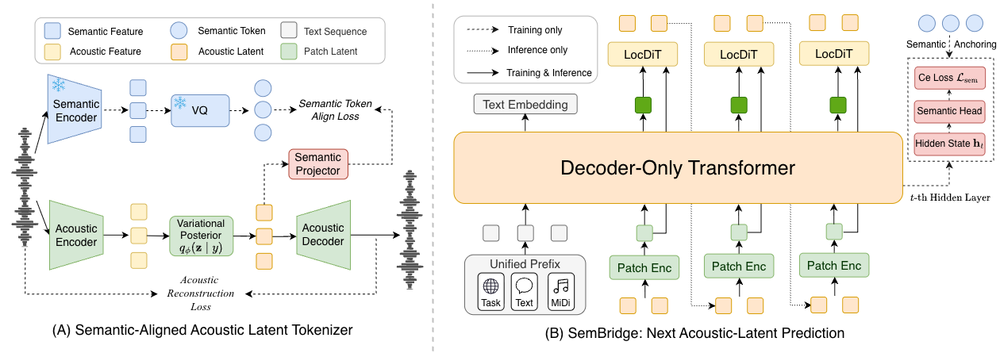

<div align="center">
  <h1>SemBridge</h1>
  <p><strong>Semantic Token Anchoring for Continuous-Latent Autoregressive Speech Generation</strong></p>
  <p><em>Speech. Singing. One continuous voice.</em></p>
  <p>
    <a href="https://arxiv.org/pdf/2608.07462"></a>
    <a href="https://tiamojames.github.io/SemBridge_Demo/"></a>
    <a href="https://huggingface.co/ASLP-lab/SemBridge"></a>
    <a href="LICENSE"></a>
  </p>
  <p>
    <a href="#introduction">Introduction</a> &nbsp;&middot;&nbsp;
    <a href="#installation">Installation</a> &nbsp;&middot;&nbsp;
    <a href="#inference">Inference</a> &nbsp;&middot;&nbsp;
    <a href="#citation">Citation</a>
  </p>
</div>

## Introduction

SemBridge bridges discrete semantic supervision and continuous acoustic generation.
A shared semantic tokenizer anchors both acoustic latents and autoregressive language-model
states, improving linguistic fidelity while retaining continuous-latent generation.
The unified model supports **text-to-speech**, **note-conditioned singing**, and
**mixed speech and singing**.

<div align="center">
  
</div>

## News

- **[2026-10]**: Released the [inference code](https://github.com/ASLP-lab/SemBridge) and [model checkpoints](https://huggingface.co/ASLP-lab/SemBridge).
- **[2026-08]**: Released the [arXiv paper](https://arxiv.org/pdf/2608.07462).

## Installation

Use **Python 3.10+** and a matching **PyTorch / torchaudio 2.6-2.8** pair.
CUDA inference is recommended; BigVGAN uses standard PyTorch operations and
does not require custom CUDA extensions.

```bash
conda create -n sembridge python=3.10 -y
conda activate sembridge

git clone https://github.com/ASLP-lab/SemBridge.git
cd SemBridge

# CUDA 12.4 example; choose a build compatible with your NVIDIA driver.
python -m pip install torch==2.6.0 torchaudio==2.6.0 \
  --index-url https://download.pytorch.org/whl/cu124
python -m pip install -e .
```

For other CUDA versions or CPU-only installation, use the
[official PyTorch installation commands](https://pytorch.org/get-started/previous-versions/).
Keep the `torch` and `torchaudio` versions matched. Run the examples below from
the repository root.

## Inference

```python
from sembridge import SemBridge
from sembridge.requests import load_request

# Automatically download and load the checkpoint.
model = SemBridge.from_pretrained(
    "ASLP-lab/SemBridge", device="cuda", dtype="bfloat16"
)
model.generate_to_file(
    "outputs/singing.wav",
    **load_request("examples/svs/zh_r001.json"),
)
```

| Task | Input | Default decoder |
| :--- | :--- | :--- |
| **TTS** | Text | Native causal |
| **SVS** | Lyrics, MIDI pitches, note durations | BigVGAN-Large |
| **Unified** | Ordered speech and singing segments | BigVGAN-Large |

### Examples

The repository includes **10 complete examples from our [Demo page](https://tiamojames.github.io/SemBridge_Demo/)**:
4 TTS, 4 SVS, and 2 Unified cases, with reference audio and prepared requests.
SVS and Unified include **aligned lyrics, pitches, durations, and note-continuation labels**;
you do not need to prepare MIDI files or write note JSON to try them.

```bash
# Browse the available examples without loading a model
bash scripts/infer_examples.sh --list

# Run all four singing examples
CUDA_VISIBLE_DEVICES=0 bash scripts/infer_examples.sh --task svs

# Run one speech-singing-speech example
CUDA_VISIBLE_DEVICES=0 bash scripts/infer_examples.sh --example unified_zh_novel_wukong

# Run all 10 examples; the model is loaded only once
CUDA_VISIBLE_DEVICES=0 bash scripts/infer_examples.sh
```

Audio is saved to `outputs/examples/<example_id>.wav`. Set `MODEL=/path/to/SemBridge`
to use local weights. See the **[example catalog](examples/README.md)** for the
complete list, reference recordings, and guidance on using your own songs.

### Single Request

```bash
# Text-to-speech
sembridge-infer --model ASLP-lab/SemBridge --task tts \
  --input examples/tts/zh_r001.json --output outputs/tts.wav \
  --device cuda --dtype bfloat16

# Singing voice synthesis
sembridge-infer --model ASLP-lab/SemBridge --task svs \
  --input examples/svs/zh_r001.json --output outputs/svs.wav \
  --device cuda --dtype bfloat16

# Mixed speech and singing
sembridge-infer --model ASLP-lab/SemBridge --task unified \
  --input examples/unified/zh_novel_wukong.json --output outputs/unified.wav \
  --device cuda --dtype bfloat16
```

Outputs are **mono, 44.1 kHz WAV**. `--decoder auto` uses the defaults above;
`--decoder native` or `--decoder bigvgan` selects a decoder explicitly for any task.
Prepared requests include per-example generation settings, which both entry points
honor. Explicit CLI options override those settings. Without request-specific limits,
`--max-patches 500` caps generation at 40 seconds; generation can stop earlier.

Add `prompt_audio` and its matching `prompt_text` for reference-conditioned generation.
Reference audio is automatically downmixed and resampled to 44.1 kHz.
For SVS, each note contains `text`, MIDI `pitch`, and `duration` **in seconds**.

See the **[inference guide](docs/INFERENCE.md)** for reference voices, singing and
mixed-generation examples, sampling controls, and offline loading.

## Acknowledgements

We thank the authors of the following projects for their open research and resources:

- **Speech generation:** [VoxCPM](https://github.com/OpenBMB/VoxCPM) and [DiTAR](https://arxiv.org/abs/2502.03930).
- **Audio codecs:** [DAC](https://github.com/descriptinc/descript-audio-codec), [SAC](https://github.com/Soul-AILab/SAC), and [BigVGAN](https://github.com/NVIDIA/BigVGAN).

## Citation

If you find SemBridge useful in your research, please cite:

```bibtex
@article{xie2026sembridge,
  title = {SemBridge: Semantic Token Anchoring for Continuous-Latent Autoregressive Speech Generation},
  author = {Hanke Xie and Haopeng Lin and Jiale Qian and Dake Guo and Yuepeng Jiang and Zhichao Wang and Wenxiao Cao and Jingbin Hu and Guobin Ma and Wenhao Li and Huakang Chen and Chengyou Wang and Ming Tao and Zhonghua Fu and Lei Xie and Xinsheng Wang},
  journal = {arXiv preprint arXiv:2608.07462},
  year = {2026},
  eprint = {2608.07462},
  archivePrefix = {arXiv},
  primaryClass = {eess.AS},
  url = {https://arxiv.org/abs/2608.07462}
}
```

## License

SemBridge code is released under Apache-2.0; upstream portions retain their
original licenses. See [LICENSE](LICENSE) for terms and third-party notices.
Model weights and third-party resources are subject to their respective licenses.
Use reference recordings only with permission, and disclose synthetic audio where appropriate.
